# Rundot

[](https://pypi.org/project/rundot)


**Markdown that runs.**

Rundot runs the code blocks in a markdown file, one step at a time. Write a release checklist, a deploy or a setup guide once, and run it the same way every time.



🌐 [rundot.dev](https://rundot.dev) · 📚 [Documentation](https://docs.rundot.dev/) · 🤖 [Prompt for your LLM](https://rundot.dev/prompt.txt)

## What people use it for

- **Release checklists** - Tag, build, publish, announce. In order, every time.
- **Incident runbooks** - The steps you need at 3am, already checked.
- **Dev setup** - One setup guide that works the same on every machine.
- **Onboarding** - Guides new contributors can run, not just read.
- **Deploys** - Ask before anything destructive happens.
- **Database migrations** - Backups and safety checks built into the steps.
- **Agent procedures** - Fixed steps for your LLM to follow.
- **Rare chores** - The job you do twice a year and always forget.

## It's just markdown

Save this as `hello.md`:

````markdown
---
title: Say hello
inputs:
  - name: NAME
    description: Who to say hello to
---

# Say hello

A runbook is just markdown. rundot runs the blocks marked `run`, shows the
`docstring` ones, and leaves everything else alone, like this paragraph.

## Greet

```docstring
Saying hello to <NAME>.
```

```sh run
echo "Hello, <NAME>!"
```

## Count the letters

```python run
import os

name = os.environ["NAME"]
print(f"{name} has {len(name)} letters")
```
````

Check it, then run it:

```sh
rundot check hello.md
rundot hello.md
```

rundot asks for the inputs, shows the plan, and runs each step in order. A runbook reads like documentation and renders on GitHub, so it's still useful without rundot installed.

## Know it works before it runs

`rundot check` catches broken frontmatter, undeclared placeholders, and shell or Python syntax errors, with line numbers.

`rundot --dry hello.md` prints every command with its inputs filled in, and runs nothing.

Go one step at a time with `--step`, and see each block's code as it runs with `--show-code`.

## Pause for the bits only a person can do

A `confirm` block stops the run until someone answers `y`:

````md
```confirm
Publish the GitHub release notes for v<VERSION>.
```
````

Inputs can be checked against a pattern or a list of choices. Secrets are hidden as you type them and shown as `****` in the output and the transcript.

## Your runbooks, everywhere

Keep runbooks you use across projects in `~/runbooks`, and run them by name from anywhere:

```
$ rundot library
library: /home/you/runbooks
rebuild-frontend     Rebuild the frontend
update-project-deps  Update a project's dependencies

$ cd ~/Projects/website
$ rundot rebuild-frontend
```

A book runs in the folder you're in, so the same one works in every project. See [Your runbook library](https://docs.rundot.dev/library/).

## Agents improvise. Runbooks don't.

A runbook gives an agent a fixed set of steps to follow instead of working them out each time. Paste [this prompt](https://rundot.dev/prompt.txt) into your chat, or into your `CLAUDE.md` or `AGENTS.md`. It teaches the format and asks the agent to check and dry-run every runbook before running it.

An agent runs a runbook with `--no-input --json`: nothing waits for an answer, and each event is a line of JSON. When a step needs a person, such as a `confirm`, the run stops with exit code 3 and says what to do. Once it's done, the agent runs the same command again, and the run carries on from there.

## Also in rundot

- **Transcripts** - Set `output_path` to keep every command, its output and how the run ended.
- **More than shell** - Shell and Python are built in. Other languages can be added as backends.

## Install

rundot is a command-line tool, so install it on its own rather than into a project:

```sh
uv tool install rundot
```

Or with pip:

```sh
pip install rundot
```

rundot needs Python 3.12 or later and `bash`, and runs on **macOS and Linux**. Windows isn't supported.

## Getting started

👉 Read the [full documentation](https://docs.rundot.dev/) for the runbook format, every command, and writing your own backend.

See [`examples/`](https://github.com/phalt/rundot/tree/main/examples) for more runbooks, including a real release, and [`PUBLISHING.md`](https://github.com/phalt/rundot/blob/main/PUBLISHING.md) for the runbook rundot releases itself with.

Want to help? See [CONTRIBUTING.md](https://github.com/phalt/rundot/blob/main/CONTRIBUTING.md).
