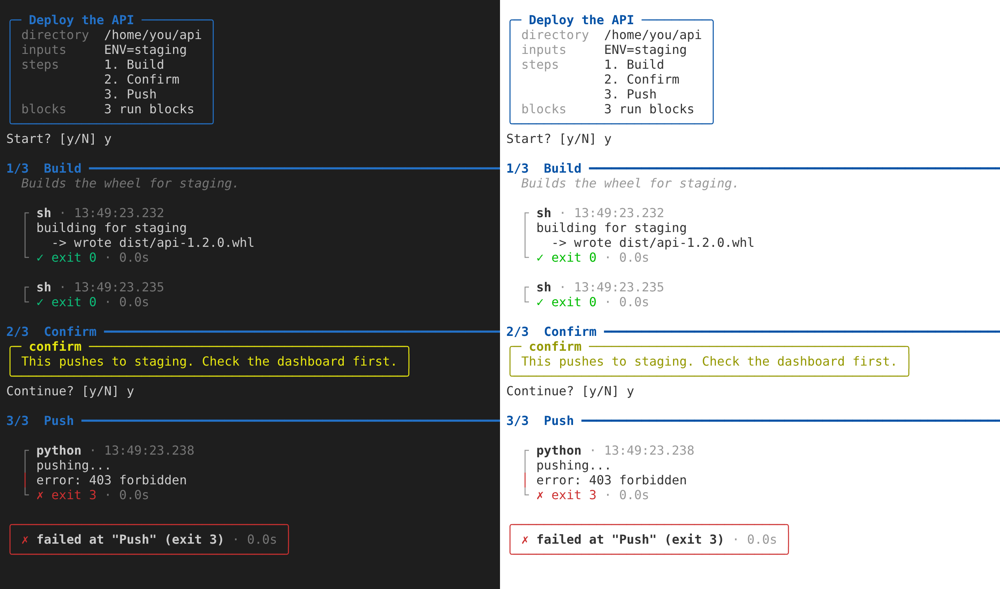

# 🏃‍♂️‍➡️📕 paulrun

## What is paulrun?

paulrun executes the code blocks in your markdown file, turning them into runbooks.

A runbook is just a normal markdown file that a person can read and write, but if you annotate a code block `run`, then paulrun can execute the code blocks for you, helping you to automate tedious multi-step tasks.

<div style="text-align: center; padding-top:10px;">
<p>
    <a href="https://pypi.org/project/paulrun">
    
    </a>
    
    
</p>
</div>



## Example runbook

````markdown
---
title: Release my-package
output_path: logs/release-<VERSION>.md
inputs:
  - name: VERSION
    description: The version to release, e.g. 1.2.0
    pattern: '^\d+\.\d+\.\d+$'
---

# Releasing my-package

## Run the tests

```sh run
make test
```

## Tag the release

```sh run
git tag <VERSION>
git push origin <VERSION>
```

## Publish on GitHub

```confirm
Create a GitHub release from tag <VERSION>.
```
````

Check it, then run it:

```sh
paulrun check RELEASING.md
paulrun RELEASING.md
```

paulrun asks for the version, shows you the plan, and runs each step in order, streaming every command's output as it goes. It stops at the first command that fails, and waits for you at the GitHub step, since that one is done by hand:

```
VERSION (The version to release, e.g. 1.2.0): 1.2.0
╭─ Release my-package ─────────────────────╮
│ directory  /home/you/Projects/my-package │
│ inputs     VERSION=1.2.0                 │
│ steps      1. Run the tests              │
│            2. Tag the release            │
│            3. Publish on GitHub          │
│ blocks     2 run blocks                  │
╰──────────────────────────────────────────╯
Start? [y/N] y

1/3  Run the tests ━━━━━━━━━━━━━━━━━━━━━━━━━━━━━━━━━━━━━

  ┌ sh · 10:02:13.482
  │ ...
  └ ✓ exit 0 · 4.2s

2/3  Tag the release ━━━━━━━━━━━━━━━━━━━━━━━━━━━━━━━━━━━

  ┌ sh · 10:02:17.705
  │ ...
  └ ✓ exit 0 · 1.3s

3/3  Publish on GitHub ━━━━━━━━━━━━━━━━━━━━━━━━━━━━━━━━━
╭─ confirm ───────────────────────────────╮
│ Create a GitHub release from tag 1.2.0. │
╰─────────────────────────────────────────╯
Continue? [y/N] y

╭───────────────────────╮
│ ✓ finished ok · 12.8s │
╰───────────────────────╯
transcript: logs/release-1.2.0.md
```

Every run is also recorded in `logs/release-1.2.0.md`, so you can see afterwards exactly what ran and what it printed.

## Your runbook library

Keep runbooks you use across projects in `~/runbooks`, and run them by name from anywhere:

```
$ paulrun library
library: /home/you/runbooks
rebuild-frontend     Rebuild the frontend
update-project-deps  Update a project's dependencies

$ cd ~/Projects/website
$ paulrun rebuild-frontend
```

A book runs in the folder you're in, so one book works for every project. See [Your runbook library](library.md).

## Why use paulrun?

Release steps get forgotten. Writing them down helps; making the written-down version run itself fixes it.

- **It's just markdown** - A runbook reads like documentation, renders on GitHub, and works fine without paulrun.
- **Check before you run** - `paulrun check` finds broken frontmatter, undeclared placeholders and syntax errors.
- **See what would happen** - `paulrun --dry RELEASING.md` shows every command with its inputs filled in, and runs nothing.
- **Inputs and secrets** - Ask for values once, check them against a pattern, and keep secrets off the screen and out of the log.
- **Manual steps too** - `confirm` blocks pause for the things only a person can do.
- **A record of every run** - An optional transcript keeps every command, its output and how it finished.
- **More than shell** - Shell and Python blocks are built in, and other languages can be added as backends.

## Next steps

- [Install paulrun](install.md)
- [The runbook format](runbook-format.md): everything a runbook can contain
- [The command line](cli.md): every command, flag and exit code
- [Your runbook library](library.md): runbooks you keep for yourself, and run from anywhere
- [Backends](backends.md): the languages paulrun runs, and adding your own
